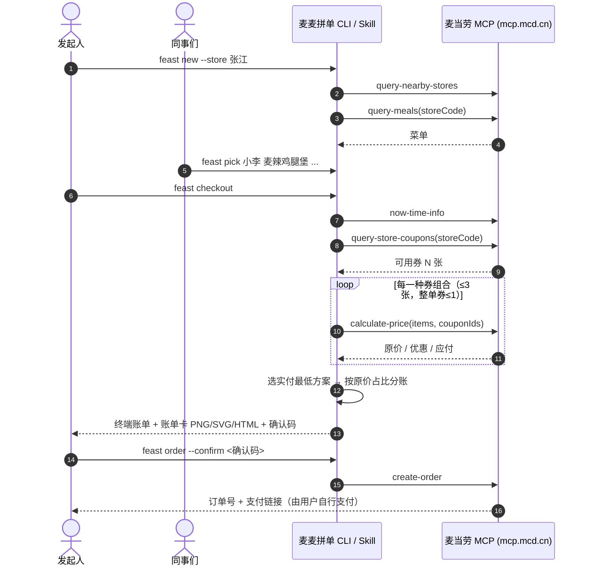

# 麦当劳 MCP 集成说明

## MCP Server

| 项目 | 值 |
|---|---|
| Server | 麦当劳 MCP Server（`mcd-mcp`） |
| 地址 | `https://mcp.mcd.cn` |
| 传输 | Streamable HTTP（JSON-RPC 2.0，兼容 JSON / SSE 两种响应） |
| 鉴权 | `Authorization: Bearer ${MCD_MCP_TOKEN}`（仅从环境变量读取，仓库内无任何真实凭证） |
| 客户端实现 | [`src/mcp.js`](src/mcp.js)，零依赖：`initialize` → `notifications/initialized` → `tools/list` / `tools/call`，自动携带 `Mcp-Session-Id` |

配置示例见 [`mcp-config.example.json`](mcp-config.example.json)。

## 使用的 Tool

| Tool | 在本项目中的用途 | 调用位置 |
|---|---|---|
| `query-nearby-stores` | 根据地址/关键词查找门店，开团时选店 | `feast stores` / `feast new` |
| `query-meals` | 拉取门店可售菜单，缓存到团状态，供大家点餐与模糊匹配 | `feast new` |
| `query-meal-detail` | 确认套餐组成与可替换项（Skill 流程中按需调用） | `SKILL.md` |
| `query-store-coupons` | 获取当前门店可用优惠券，作为最优券搜索的候选集 | `feast checkout` / `feast order` |
| `calculate-price` | 对每一种候选券组合计价，选出实付最低方案；结果用于分账 | `feast checkout` |
| `create-order` | 创建订单并返回支付链接，**必须携带确认码** | `feast order --confirm` |
| `now-time-info` | 获取当前日期，写入账单卡（识别 1024 程序员节） | `feast checkout` |
| `available-coupons` / `auto-bind-coupons` | 券不够时，经用户同意后一键领取麦麦省优惠券 | `SKILL.md` |
| `campaign-calendar` | 查询当月活动，提示是否有节日专属优惠 | `SKILL.md` |
| `list-nutrition-foods` | 为控卡同事提供热量参考 | `SKILL.md` |

## 调用流程

## 安全设计

- **不会自动下单**：`create-order` 只在 `feast order --confirm <确认码>` 时调用；确认码由门店、合并后的餐品和券组合哈希得到，团内容一变确认码即失效。
- **测试零真实调用**：单元测试全部使用 `--mock` 与本地计价函数。
- **凭证不落盘**：Token 只从环境变量读取。

## 业务价值

1. **把“团餐”变成可复用的 Skill**：工作群里最常见的“谁要什么、怎么凑满减、每人多少钱”三件事，一条命令解决，降低组织多人点餐的门槛，带来更大的客单。
2. **让优惠券真正被用上**：自动在门店可用券中搜索最优组合，用户不再错过满减，提升优惠券核销率与用户满意度。
3. **天然的社交传播**：程序员风格账单卡适合在工作群、朋友圈分享，在 1024 程序员节等节点形成自发传播。
4. **对 Agent 友好**：附带 `SKILL.md`，任何支持 MCP 的 Agent 都能直接用自然语言完成拼单。
