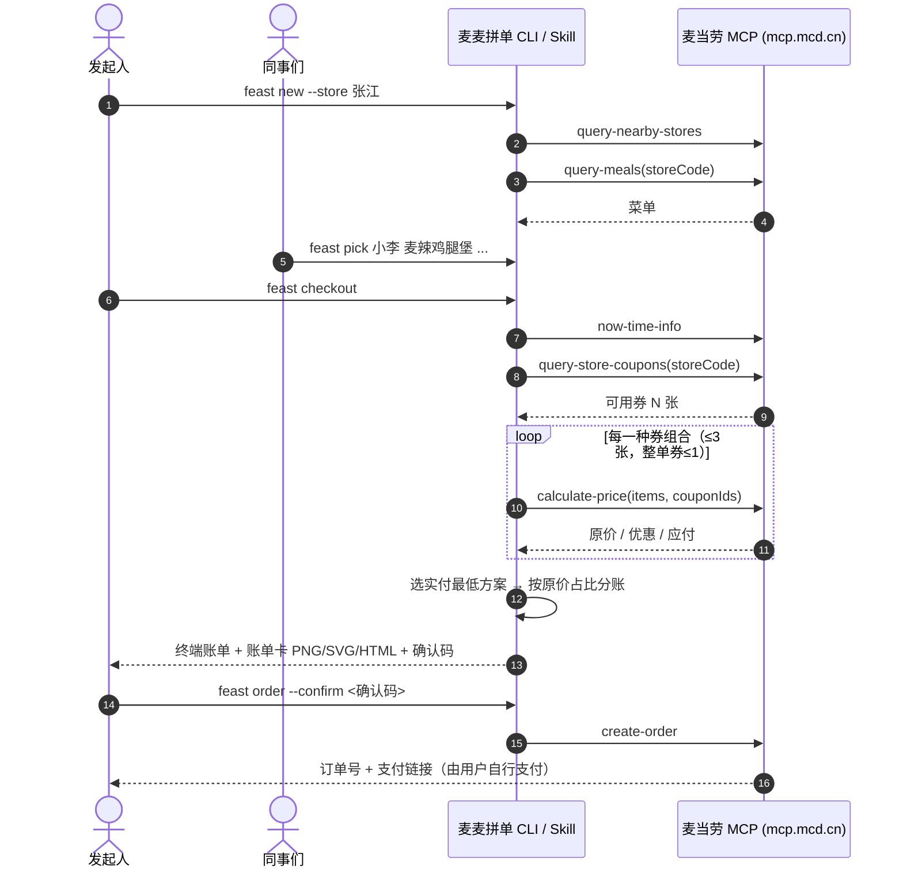

# 麦当劳 MCP 集成说明

## MCP Server

| 项目 | 值 |
|---|---|
| Server | 麦当劳 MCP Server（`mcd-mcp`） |
| 地址 | `https://mcp.mcd.cn` |
| 传输 | Streamable HTTP（JSON-RPC 2.0，兼容 JSON / SSE 两种响应） |
| 鉴权 | `Authorization: Bearer ${MCD_MCP_TOKEN}`（仅从环境变量读取，仓库内无任何真实凭证） |
| 客户端实现 | [`src/mcp.js`](src/mcp.js)，零依赖：`initialize` → `notifications/initialized` → `tools/list` / `tools/call`，自动携带 `Mcp-Session-Id` |

配置示例见 [`mcp-config.example.json`](mcp-config.example.json)。

## 使用的 Tool

| Tool | 在本项目中的用途 | 调用位置 |
|---|---|---|
| `query-nearby-stores` | 根据地址/关键词查找门店，开团时选店 | `feast stores` / `feast new` |
| `query-meals` | 拉取门店可售菜单，缓存到团状态，供大家点餐与模糊匹配 | `feast new` |
| `query-meal-detail` | 确认套餐组成与可替换项（Skill 流程中按需调用） | `SKILL.md` |
| `query-store-coupons` | 获取当前门店可用优惠券，作为最优券搜索的候选集 | `feast checkout` / `feast order` |
| `calculate-price` | 对每一种候选券组合计价，选出实付最低方案；结果用于分账 | `feast checkout` |
| `create-order` | 创建订单并返回支付链接，**必须携带确认码** | `feast order --confirm` |
| `now-time-info` | 获取当前日期，写入账单卡（识别 1024 程序员节） | `feast checkout` |
| `available-coupons` / `auto-bind-coupons` | 券不够时，经用户同意后一键领取麦麦省优惠券 | `SKILL.md` |
| `campaign-calendar` | 查询当月活动，提示是否有节日专属优惠 | `SKILL.md` |
| `list-nutrition-foods` | 为每人统计热量，账单卡与 `feast blame` 展示（返回为紧凑表格 `[N]{productName,…,energyKcal,…}:` 格式，已解析） | `feast checkout` / `feast blame` |

## 实际调用参数（以 `tools/list` 返回的 schema 为准，到店自取场景）

| Tool | 关键入参 | 解析的返回字段 |
|---|---|---|
| `query-nearby-stores` | `beType=1, searchType=2, city, keyword` | `data[].storeCode / storeName / address / distance` |
| `query-meals` | `storeCode, orderType=1, beType=1` | `data.categories[].meals[].code` + `data.meals{code}.name / currentPrice / originalPrice / discountType` |
| `query-store-coupons` | `storeCode, orderType=1, beType=1` | `data[].couponId / couponCode / title / products[].productCode`（同一券 ID 多张券码按 ID 分组） |
| `calculate-price` | `storeCode, orderType=1, beType=1, items[{productCode, quantity, couponId?, couponCode?}]` | `data.productOriginalPrice / discount / price`（单位：分），`takeWayList[]` |
| `create-order` | 同上 + `takeWayCode`（取自 `takeWayList[].code`，如 `take-in-store`） | 订单号 / 支付链接 |
| `now-time-info` | 无 | `data.formatted` |

说明：
- 优惠券是**挂在商品行上**的：本项目会为每张候选券拆出 1 份对应商品，带上 `couponId/couponCode` 交给 `calculate-price` 计价。
- 菜单中“随单购早餐卡/麦金卡优惠”价需额外购卡才能享受，拼单场景按原价计。
- 分账以 `calculate-price` 的实付为准：各人菜单价之和与实付的差额作为优惠按比例分摊，保证 Σ每人应付 = 实付。

## 真实运行样例（2026-10-16，仅计价未下单）

- 下午茶（上海南京东路食品一店餐厅）：5 人点 10 件咖啡/甜品/小食，原价 ¥159.90，门店活动价优惠 ¥19.20，实付 **¥140.70**，人均 ¥28.14（账单卡见 README）。
- 早餐（上海福州路餐厅）：5 人点 10 件早餐单品，原价 ¥139.50，门店活动价优惠 ¥14.20，实付 ¥125.30，人均 ¥25.06。

## 调用流程

## 麦麦拼单自身的 MCP Server

`feast mcp` 以 stdio 方式提供 MCP Server，内部再调用麦当劳 MCP。暴露 `feast_stores / feast_new / feast_menu / feast_pick / feast_drop / feast_list / feast_checkout / feast_blame`，**不暴露任何下单工具**。

## 安全设计

- **不会自动下单**：`create-order` 只在 `feast order --confirm <确认码>` 时调用；确认码由门店、合并后的餐品和券组合哈希得到，团内容一变确认码即失效。
- **测试零真实调用**：单元测试全部使用 `--mock` 与本地计价函数。
- **凭证不落盘**：Token 只从环境变量读取。

## 业务价值

1. **把“团餐”变成可复用的 Skill**：工作群里最常见的“谁要什么、怎么凑满减、每人多少钱”三件事，一条命令解决，降低组织多人点餐的门槛，带来更大的客单。
2. **让优惠券真正被用上**：自动在门店可用券中搜索最优组合，用户不再错过满减，提升优惠券核销率与用户满意度。
3. **天然的社交传播**：程序员风格账单卡适合在工作群、朋友圈分享，在 1024 程序员节等节点形成自发传播。
4. **对 Agent 友好**：附带 `SKILL.md`，任何支持 MCP 的 Agent 都能直接用自然语言完成拼单。
