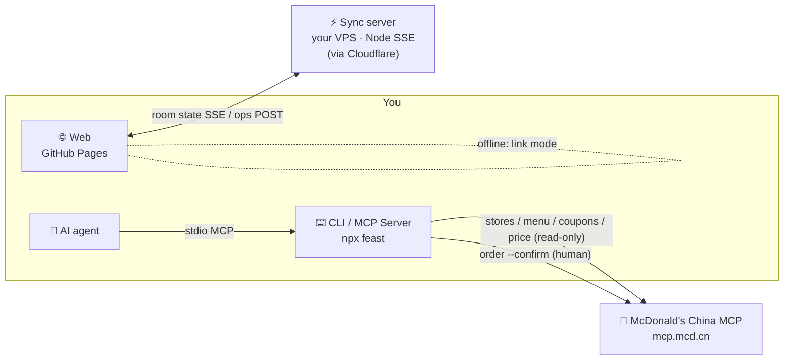

<div align="center">

[](https://jasonin2099.github.io/mcd-team-feast/)
[](https://github.com/Jasonin2099/mcd-team-feast/stargazers)
[](https://github.com/Jasonin2099/mcd-team-feast/commits/main)
[](LICENSE)
[](https://developer.mozilla.org/docs/Web/JavaScript)

[中文](README.md) | **English** | [日本語](README.ja.md)


# 🍔 mcd-team-feast · 麦麦拼单

**Open a group → sync live → lock the order. Share one link, everyone picks their own; it finds the cheapest coupon combo, works out who owes what, and prints a `git log`-style receipt card.**

> Real run (priced live via McDonald's China MCP): a 5-person afternoon-tea order, list price ¥159.90 → paid **¥140.70**, **¥28.14** per person.

[](https://github.com/Jasonin2099/mcd-team-feast/stargazers)
[](https://nodejs.org)
[](https://github.com/M-China/mcd-mcp-server)
[](package.json)
[](https://github.com/Jasonin2099/mcd-team-feast/actions/workflows/test.yml)
[](https://jasonin2099.github.io/mcd-team-feast/)
[](LICENSE)

**[🌐 Live demo](https://jasonin2099.github.io/mcd-team-feast/)** · **[⚡ Real-time](#-real-time-group-orders-open--sync--lock)** · **[🚀 Quick start](#-quick-start)** · **[🤖 AI agents](#-ai-agents)**


<sub>↑ Recorded from three browsers side by side: host opens a group → two members join from the link → picks sync live → host locks → final split (demo data, UI in Chinese)</sub>

**If it helps, please ⭐ star it so more people can find it.**

</div>

> **Live ordering works with McDonald's China (mainland) only.** Real data comes from the official [McDonald's China MCP Server](https://github.com/M-China/mcd-mcp-server), and a token requires a mainland Chinese phone number. Outside China, think of this as a fun open-source project for Programmer's Day (Oct 24, "1024"): everything runs with `--mock` sample data, and the [web demo](https://jasonin2099.github.io/mcd-team-feast/) is fully playable in your browser. The bill-splitting, coupon search and receipt cards are plain JavaScript you're welcome to borrow.

## ⚡ Real-time group orders: open → sync → lock

| ① Open | ② Sync live | ③ Lock |
|---|---|---|
| Name the group, tap “Go live”, get a room link and QR code | Members join with a nickname; everyone sees who's online, who's done and who's still choosing; the host sees totals, per-person subtotals and an optional countdown | One tap locks the order: members become read-only and see the final split; unlock any time |

- Reconnects automatically after drops or backgrounding; if the sync server is unreachable it falls back to **link mode** (all data in the URL), and the UI always says which mode you're in.
- The server keeps **nicknames and picks only**; rooms are deleted after **24 hours**. Zero-dependency server, source in [`server/`](server/) — self-host it if you like.

## ✨ Features

| | | |
|---|---|---|
| ⚡ **Real-time sync**<br><sub>presence, done, countdown, lock</sub> | 🎟 **Best coupon combo**<br><sub>tries combos via `calculate-price`, keeps the cheapest</sub> | 🧮 **Fair split**<br><sub>discount shared by list price, exact to the cent</sub> |
| 🧾 **Three receipt cards**<br><sub>git log / GitHub PR / receipt, fonts embedded</sub> | 🌐 **Web, no install**<br><sub>zh/en/ja, light/dark, WeChat long-press save</sub> | 📋 **Payment message**<br><sub>“@Li pay Wang ¥24.90”, copy and send</sub> |
| 🤖 **MCP Server + Skill**<br><sub>let your agent run the group order</sub> | 🔍 **`feast blame`**<br><sub>top spender, calorie champion</sub> | 🛡 **Never orders by accident**<br><sub>confirm code required; no order tool in MCP</sub> |

## 🧾 Real receipt card

<div align="center">


<sub>↑ Priced live via McDonald's China MCP at a Shanghai store (pseudonyms; priced only, not ordered)</sub>
</div>

| `git` | `pr` | `receipt` |
|:---:|:---:|:---:|
|  |  |  |

✍️ **Meme signature**: every card ends with a programmer one-liner picked from context (time of day, team size, savings, calories). Shuffle 🎲, pick from a list or write your own; CLI: `--sign random` / `--sign 'text'`. A small footer carries the repo link and a QR code.

## 🛡 Why it's safe

- **Never auto-orders**: the web app only prices and splits; the CLI needs the confirm code from `checkout`; the MCP server has no order tool at all.
- **Token stays local**: the McDonald's MCP token is read from your local environment only — never uploaded or committed. The web app needs no token.
- **Nicknames only**: rooms store group name, nicknames and picks — no phone, no login — and are deleted after **24 h**.
- **Works offline**: link mode keeps everything in the URL.
- **Open and auditable**: zero dependencies; web, CLI and sync server all live here.

## 🏗 Architecture



## 🚀 Quick start

**Web**: open [jasonin2099.github.io/mcd-team-feast](https://jasonin2099.github.io/mcd-team-feast/) → Start → Go live → share the link.

**CLI in 30 seconds (no token)**:

```bash
npx github:Jasonin2099/mcd-team-feast demo --mock --theme all
```


<details>
<summary><b>Connect the real McDonald's China MCP (mainland China)</b></summary>

1. Sign in at the [McDonald's China open platform](https://open.mcd.cn/mcp) (mainland phone number required) and get an MCP token;
2. Export it (never commit it):

```bash
export MCD_MCP_TOKEN=your_token
alias feast="npx -y github:Jasonin2099/mcd-team-feast"
```

3. Run a real group:

```bash
feast stores 福州路 --city 上海
feast new --store 1450441 --title "1024 snacks" --by Wang
feast menu
feast pick Li 麦咖啡™美式
feast checkout --theme all
feast order --confirm 3f9a1c    # only after you check everything
```
</details>

<details>
<summary><b>🧭 Commands</b></summary>

| Command | What it does |
|---|---|
| `demo` | One-shot demo: open → 5 people pick → coupons → split → cards |
| `stores [keyword] [--city]` | Find stores |
| `new --store <code> [--title] [--by]` | Open a group and cache the menu |
| `menu` / `list` | Show menu / current group |
| `pick <name> <item> [qty]` / `drop <name>` | Add a pick / remove someone |
| `checkout [--theme git\|pr\|receipt\|all]` | Price, split and render cards |
| `blame` / `diff` | Easter eggs |
| `order --confirm <code>` | Place the order (explicit confirm) |
| `mcp` / `tools` | Run as MCP server / list McDonald's MCP tools |

Every command accepts `--mock`.
</details>

## 🤖 AI agents

Merge [`mcp-config.example.json`](mcp-config.example.json) into your MCP config or drop [`SKILL.md`](SKILL.md) into your agent's skills, then just ask it to organise a McDonald's group order.

<details>
<summary>MCP config and tools</summary>

```json
{
  "mcpServers": {
    "mcd-team-feast": {
      "command": "npx",
      "args": ["-y", "github:Jasonin2099/mcd-team-feast", "mcp"],
      "env": { "MCD_MCP_TOKEN": "${MCD_MCP_TOKEN}" }
    }
  }
}
```

Tools: `feast_stores / feast_new / feast_menu / feast_pick / feast_drop / feast_list / feast_checkout / feast_blame` — **no order tool**. See [MCP_INTEGRATION.md](MCP_INTEGRATION.md) (Chinese).
</details>

<details>
<summary><b>🖥 Self-host the sync server</b></summary>

One zero-dependency file, Node ≥18:

```bash
PORT=8787 DATA=/var/lib/feast-sync/rooms.json ORIGINS=https://your.site node server/sync-server.js
```

- systemd unit and nginx config in [`server/deploy/`](server/deploy/); SSE needs `proxy_buffering off`.
- Point the web app at it with `?sync=https://your-sync-server`.
- Details (API, limits, auth, 24 h expiry) in [`server/README.md`](server/README.md).
</details>

## 🗺 Roadmap

- [x] CLI + MCP server + Skill, live McDonald's MCP pricing
- [x] Web: link mode, three cards, zh/en/ja, light/dark
- [x] Real-time rooms: presence, countdown, lock/unlock, QR
- [x] Embedded card fonts — exports look the same everywhere
- [ ] CLI `feast join <room>`
- [ ] Real store menus on the web (local token proxy)
- [ ] Per-person budgets and other split rules

## ❓ FAQ

<details><summary>Will it order or charge me?</summary>No. The web app only prices and splits. An order is created only when you run <code>feast order --confirm &lt;code&gt;</code> yourself, and you pay via the returned link.</details>
<details><summary>Are the web menu and prices real?</summary>The web app uses a demo menu with made-up prices: 20 items across 7 categories (burgers, set meals, fried chicken, snacks, desserts, drinks, McCafé), with a jump bar at the top of the menu. Real menus, coupons and prices come from the CLI with McDonald's China MCP.</details>
<details><summary>The sync server won't connect?</summary>It falls back to link mode automatically. Right after a new domain goes live, some networks cache DNS for up to ~30 minutes — try again later.</details>

## 🙏 Acknowledgements & contributing

- [McDonald's China MCP](https://github.com/M-China/mcd-mcp-server) and the M-CODE contest
- Fonts: [Noto Sans CJK](https://github.com/notofonts/noto-cjk), [JetBrains Mono](https://www.jetbrains.com/lp/mono/) (SIL OFL 1.1)
- QR: [qrcode-generator](https://github.com/kazuhikoarase/qrcode-generator) (MIT)

<a href="https://github.com/Jasonin2099/mcd-team-feast/graphs/contributors"></a>

PRs welcome — see [CONTRIBUTING.md](CONTRIBUTING.md). `npm test` runs 83 zero-dependency tests (Node 18+).

## 📈 Star History

[](https://star-history.com/#Jasonin2099/mcd-team-feast&Date)

## ⚠️ Disclaimer

> 🏁 The M-CODE contest ended on 2026-10-26; this entry did not place. The project carries on as a regular open-source tool — issues and PRs are welcome.

An entry for McDonald's China's Programmer's Day developer contest, built independently — **not an official McDonald's product**. Items, prices and coupons in `--mock` and the web app are fictional; real availability and prices come from official McDonald's channels. Calorie data is for reference only. MIT License.

<div align="center">

### ⭐ If it helps, a star means a lot!

</div>
