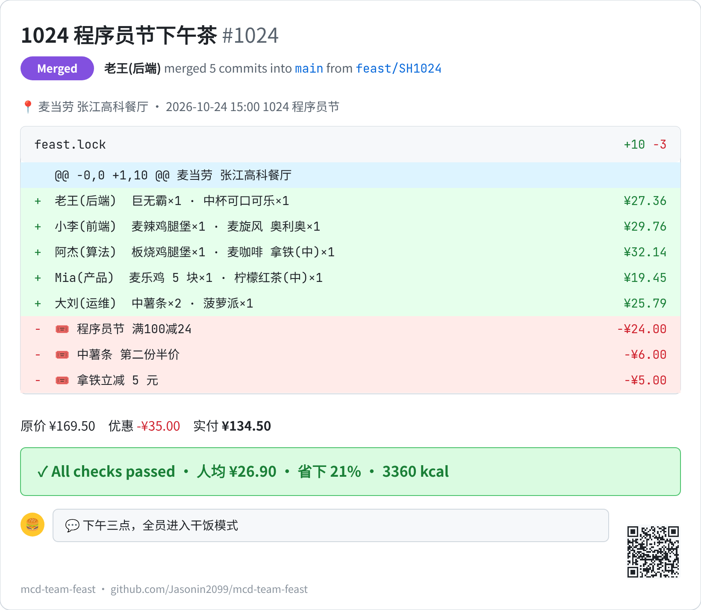
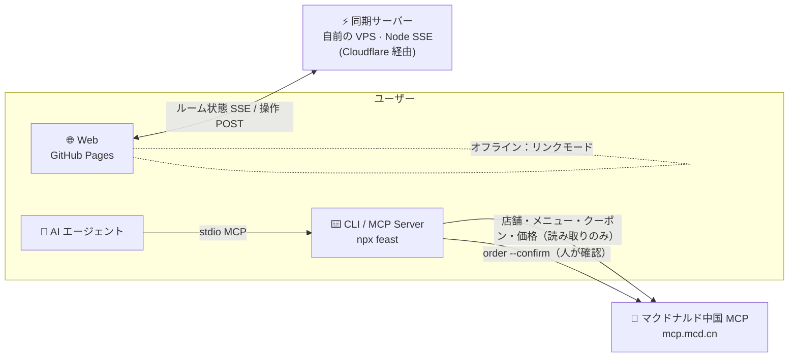

<div align="center">

[](https://jasonin2099.github.io/mcd-team-feast/)
[](https://github.com/Jasonin2099/mcd-team-feast/stargazers)
[](https://github.com/Jasonin2099/mcd-team-feast/commits/main)
[](LICENSE)
[](https://developer.mozilla.org/docs/Web/JavaScript)

[中文](README.md) | [English](README.en.md) | **日本語**


# 🍔 麦麦拼单 · mcd-team-feast

**グループを作る → リアルタイム同期 → 注文を確定。リンクを 1 本送るだけで、みんなが好きなものを選べます。いちばん安いクーポンの組み合わせを探し、誰がいくら払うかを計算して、`git log` 風のレシートカードまで作ります。**

> 実測例（マクドナルド中国の公式 MCP で計算）：5 人分の午後のおやつで、定価 ¥159.90 → 支払い **¥140.70**、1 人あたり **¥28.14**。

[](https://github.com/Jasonin2099/mcd-team-feast/stargazers)
[](https://nodejs.org)
[](package.json)
[](https://github.com/Jasonin2099/mcd-team-feast/actions/workflows/test.yml)
[](https://jasonin2099.github.io/mcd-team-feast/)
[](LICENSE)

**[🌐 Web デモ](https://jasonin2099.github.io/mcd-team-feast/)** · **[⚡ リアルタイム](#-リアルタイム共同注文作成--同期--確定)** · **[🚀 クイックスタート](#-クイックスタート)** · **[🤖 AI エージェント](#-ai-エージェント)**


<sub>↑ 3 つのブラウザを並べて録画：幹事がグループ作成 → 2 人がリンクから参加 → 注文がリアルタイム同期 → 幹事が確定 → 最終の割り勘（デモデータ・画面は中国語）</sub>

**役に立ったら ⭐ Star をお願いします。**

</div>

> **実際の注文・価格計算は、マクドナルド中国（中国本土）でしか使えません。** データはマクドナルド中国の公式 [MCP Server](https://github.com/M-China/mcd-mcp-server) から取得しており、トークンの発行には中国本土の電話番号が必要です。日本から触る場合は、「1024（中国のプログラマーの日、10 月 24 日）向けのネタ系 OSS」として楽しんでもらえればうれしいです。`--mock` のサンプルデータで全機能が動き、[Web デモ](https://jasonin2099.github.io/mcd-team-feast/)もブラウザだけで遊べます。割り勘ロジックやクーポン探索、カード描画はただの JavaScript なので、自由に流用してください。

## ⚡ リアルタイム共同注文：作成 → 同期 → 確定

| ① 作成 | ② リアルタイム同期 | ③ 確定 |
|---|---|---|
| グループ名を入れて「リアルタイム同期を開始」、ルームのリンクと QR を取得 | ニックネームで参加。誰がオンラインか、決めたか、選択中かを全員が見られます。幹事は集計・個人小計・締切カウントダウン | ワンタップで確定。メンバーは閲覧のみになり最終の割り勘を表示。解除も可能 |

- 切断やバックグラウンド後は自動で再接続。同期サーバーに届かないときは**リンクモード**（データはすべて URL 内）に切り替わり、画面に現在のモードを表示します。
- サーバーに保存するのは**ニックネームと注文だけ**、ルームは **24 時間**で削除。依存ゼロのサーバーは [`server/`](server/) にあり、自分でもホストできます。

## ✨ 機能

| | | |
|---|---|---|
| ⚡ **リアルタイム同期**<br><sub>オンライン表示・決定・締切・確定</sub> | 🎟 **最適クーポン**<br><sub>組み合わせを `calculate-price` で試し最安を採用</sub> | 🧮 **公平な割り勘**<br><sub>定価比で割引を配分、1 分単位で一致</sub> |
| 🧾 **3 種のカード**<br><sub>git log / GitHub PR / レシート、フォント埋め込み</sub> | 🌐 **Web ですぐ使える**<br><sub>中・英・日、ライト/ダーク</sub> | 📋 **集金メッセージ**<br><sub>コピーしてそのまま送信</sub> |
| 🤖 **MCP Server + Skill**<br><sub>エージェントに頼める</sub> | 🔍 **`feast blame`**<br><sub>お財布担当・カロリー担当</sub> | 🛡 **誤注文しない**<br><sub>確認コード必須、MCP に注文ツールなし</sub> |

## 🧾 実際のレシートカード

<div align="center">


<sub>↑ マクドナルド中国 MCP で上海の店舗の価格をリアルタイム計算（名前は仮名、計算のみで注文はしていません）</sub>
</div>

| `git` | `pr` | `receipt` |
|:---:|:---:|:---:|
|  |  |  |

✍️ **ネタ署名**：カード下部にプログラマーネタの一言（時間帯・人数・節約率・カロリーから自動選択）。🎲 で入れ替え、リストから選択、自由入力も可。CLI は `--sign random` / `--sign '文言'`。フッターにリポジトリのリンクと QR コード付き。

## 🛡 安心して使える理由

- **勝手に注文しない**：Web は計算と割り勘だけ。CLI の注文には `checkout` の確認コードが必要で、MCP サーバーには注文ツール自体がありません。
- **トークンは手元だけ**：MCP トークンはローカルの環境変数からのみ読み込み、アップロードもコミットもしません。Web 版はトークン不要。
- **ニックネームだけ**：ルームに保存するのはグループ名・ニックネーム・注文のみ。電話番号もログインも不要で、**24 時間**で削除。
- **オフラインでも**：リンクモードならデータは URL の中だけ。
- **オープンソース**：依存ゼロ。Web・CLI・同期サーバーはすべてこのリポジトリに。

## 🏗 アーキテクチャ



## 🚀 クイックスタート

**Web**：[jasonin2099.github.io/mcd-team-feast](https://jasonin2099.github.io/mcd-team-feast/) を開く → 作成 → リアルタイム同期を開始 → リンクを共有。

**CLI を 30 秒で（トークン不要）**：

```bash
npx github:Jasonin2099/mcd-team-feast demo --mock --theme all
```


<details>
<summary><b>マクドナルド中国の MCP に接続する（中国本土向け）</b></summary>

1. [マクドナルド中国 オープンプラットフォーム](https://open.mcd.cn/mcp)にログインして MCP トークンを取得（中国本土の電話番号が必要）
2. 環境変数に設定（コミットしないこと）：

```bash
export MCD_MCP_TOKEN=your_token
alias feast="npx -y github:Jasonin2099/mcd-team-feast"
```

3. 実際のグループ：

```bash
feast stores 福州路 --city 上海
feast new --store 1450441 --title "1024 おやつ会" --by 王
feast menu
feast pick 李 麦咖啡™美式
feast checkout --theme all
feast order --confirm 3f9a1c    # 内容を確認してから
```
</details>

<details>
<summary><b>🧭 コマンド一覧</b></summary>

| コマンド | 内容 |
|---|---|
| `demo` | ワンショットデモ |
| `stores [キーワード] [--city]` | 店舗検索 |
| `new --store <コード> [--title] [--by]` | グループ作成・メニュー取得 |
| `menu` / `list` | メニュー / 現在のグループ |
| `pick <名前> <商品> [数量]` / `drop <名前>` | 注文追加 / 削除 |
| `checkout [--theme git\|pr\|receipt\|all]` | 計算・割り勘・カード出力 |
| `blame` / `diff` | おまけ機能 |
| `order --confirm <コード>` | 実際の注文（明示的な確認が必要） |
| `mcp` / `tools` | MCP サーバーとして起動 / ツール一覧 |

すべてのコマンドで `--mock` が使えます。
</details>

## 🤖 AI エージェント

[`mcp-config.example.json`](mcp-config.example.json) を MCP 設定に追加するか、[`SKILL.md`](SKILL.md) をスキルに入れて、「マックの共同注文をまとめて」と頼むだけ。

<details>
<summary>MCP 設定とツール</summary>

```json
{
  "mcpServers": {
    "mcd-team-feast": {
      "command": "npx",
      "args": ["-y", "github:Jasonin2099/mcd-team-feast", "mcp"],
      "env": { "MCD_MCP_TOKEN": "${MCD_MCP_TOKEN}" }
    }
  }
}
```

ツール：`feast_stores / feast_new / feast_menu / feast_pick / feast_drop / feast_list / feast_checkout / feast_blame`（**注文ツールなし**）。詳細は [MCP_INTEGRATION.md](MCP_INTEGRATION.md)（中国語）。
</details>

<details>
<summary><b>🖥 同期サーバーをセルフホスト</b></summary>

依存ゼロの 1 ファイル、Node ≥18：

```bash
PORT=8787 DATA=/var/lib/feast-sync/rooms.json ORIGINS=https://your.site node server/sync-server.js
```

- systemd と nginx の設定は [`server/deploy/`](server/deploy/)。SSE には `proxy_buffering off` が必要です。
- Web に `?sync=https://あなたの同期サーバー` を付ければ切り替えられます。
- API・制限・権限・24 時間削除は [`server/README.md`](server/README.md)。
</details>

## 🗺 ロードマップ

- [x] CLI + MCP サーバー + Skill、マクドナルド MCP による実価格
- [x] Web：リンクモード、3 種のカード、中・英・日、ライト/ダーク
- [x] リアルタイムルーム：オンライン表示、締切、確定/解除、QR
- [x] カードのフォント埋め込み（どの端末でも同じ見た目）
- [ ] CLI `feast join <ルーム>`
- [ ] Web で実店舗メニュー（ローカルのトークンプロキシ）
- [ ] 個人ごとの予算や別の割り勘ルール

## ❓ FAQ

<details><summary>勝手に注文や課金をしますか？</summary>しません。Web は計算と割り勘のみ。<code>feast order --confirm &lt;コード&gt;</code> を自分で実行したときだけ注文が作られ、支払いは返されたリンクから本人が行います。</details>
<details><summary>Web のメニューや価格は本物？</summary>Web はデモ用のメニュー（架空の価格）です。バーガー・セット・フライドチキン・サイド・デザート・ドリンク・マックカフェの 7 カテゴリ計 20 品で、メニュー上部からカテゴリへジャンプできます。実際のメニュー・クーポン・価格は CLI とマクドナルド中国 MCP で取得します。</details>
<details><summary>同期サーバーにつながらない</summary>自動でリンクモードに切り替わります。新しいドメインの公開直後は、ネットワークによって DNS が最大 30 分ほどキャッシュされることがあります。少し待って再試行してください。</details>

## 🙏 謝辞・コントリビュート

- [マクドナルド中国 MCP](https://github.com/M-China/mcd-mcp-server) と M-CODE コンテスト
- フォント：[Noto Sans CJK](https://github.com/notofonts/noto-cjk)、[JetBrains Mono](https://www.jetbrains.com/lp/mono/)（SIL OFL 1.1）
- QR：[qrcode-generator](https://github.com/kazuhikoarase/qrcode-generator)（MIT）

<a href="https://github.com/Jasonin2099/mcd-team-feast/graphs/contributors"></a>

PR 歓迎です。[CONTRIBUTING.md](CONTRIBUTING.md) を参照。`npm test` で 83 件のテスト（依存ゼロ・Node 18+）。

## 📈 Star History

[](https://star-history.com/#Jasonin2099/mcd-team-feast&Date)

## ⚠️ 免責事項

> 🏁 M-CODE コンテストは 2026-10-26 に終了しました（本作品は入賞なし）。コンテスト後も通常の OSS として引き続きメンテナンスします。Issue / PR 歓迎です。

マクドナルド中国「プログラマーの日」開発コンテストの応募作品で、参加者が独自に開発したものです。**マクドナルド公式の製品ではありません。** `--mock` と Web の商品・価格・クーポンは架空のサンプルです。実際の情報は公式チャネルをご確認ください。MIT License。

<div align="center">

### ⭐ 役に立ったら Star をお願いします！

</div>
