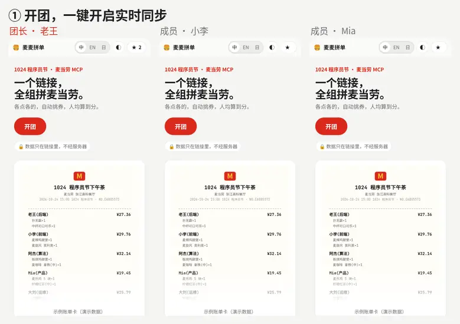
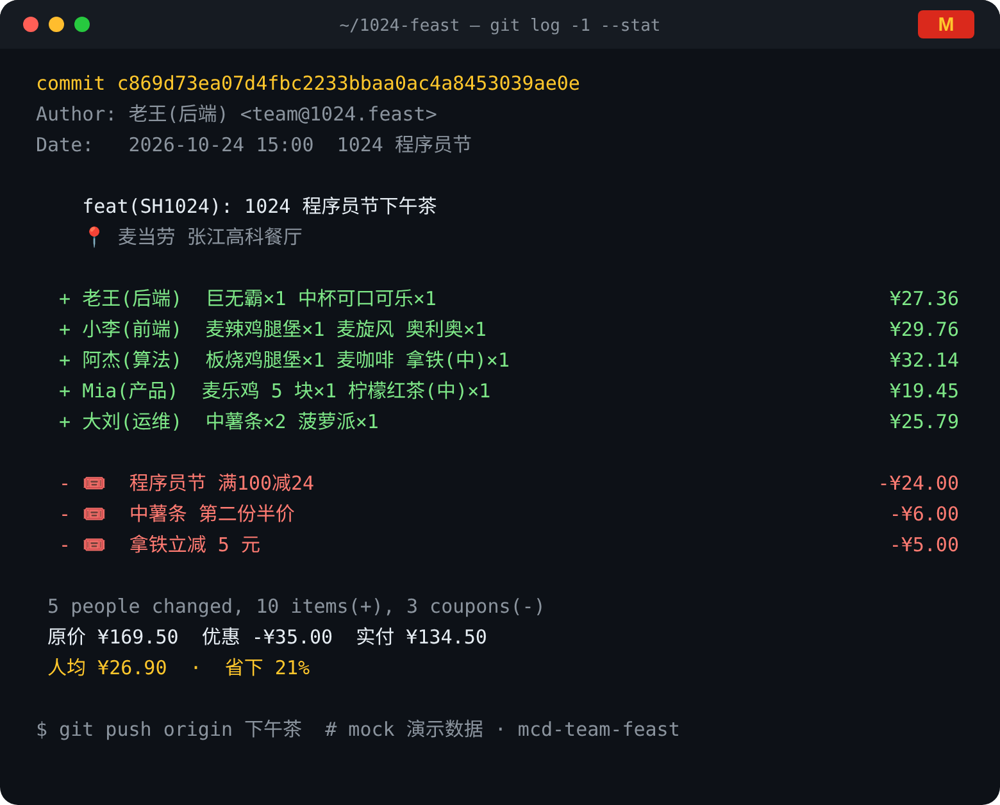
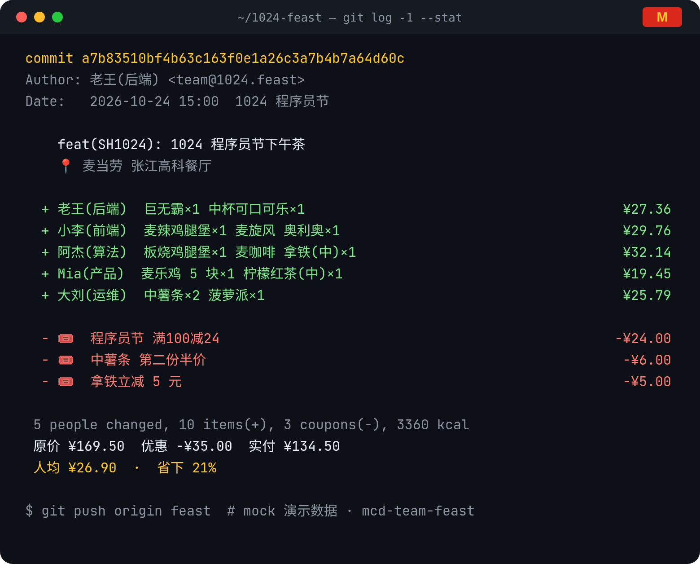
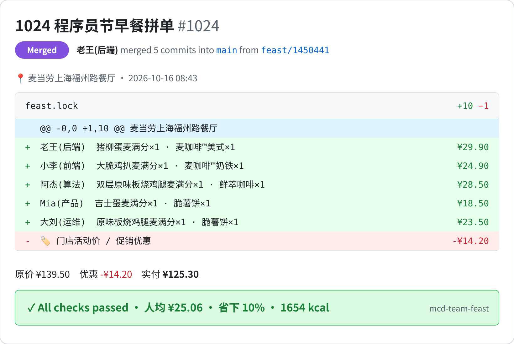
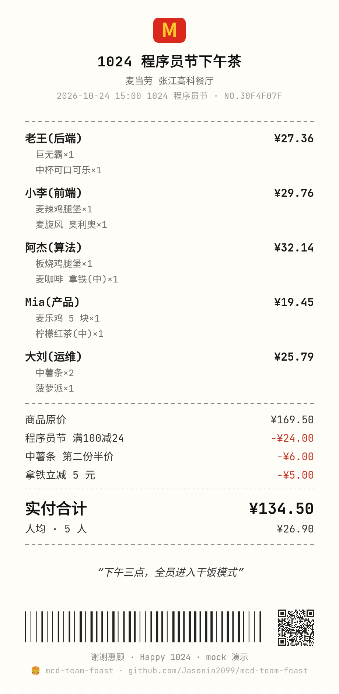
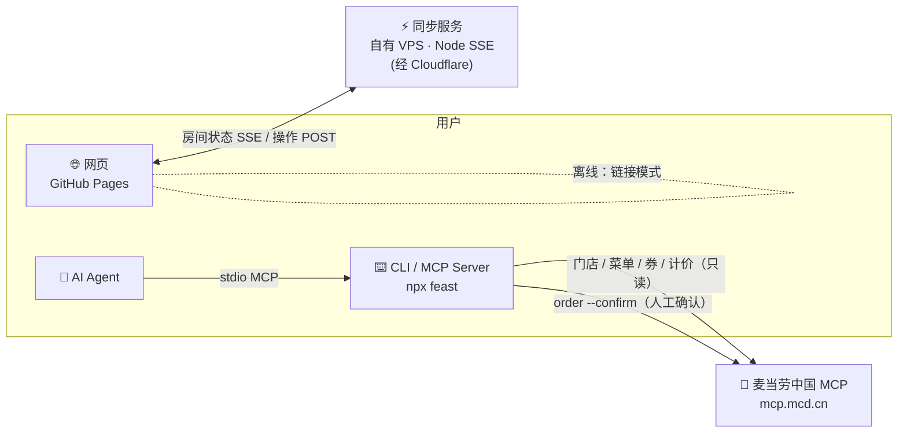

<div align="center">

**中文** | [English](README.en.md) | [日本語](README.ja.md)


# 🍔 麦麦拼单 · mcd-team-feast

**开团 → 实时同步 → 确认锁单。发一个链接，全组各点各的；它帮你挑最省的券、算好每人转多少，再出一张 `git log` 风账单卡。**

> 示例（真实麦当劳 MCP 计价）：5 人早餐拼单，原价 ¥139.50 → 实付 **¥125.30**，人均 **¥25.06**。

[](https://github.com/Jasonin2099/mcd-team-feast/stargazers)
[](https://nodejs.org)
[](https://github.com/M-China/mcd-mcp-server)
[](package.json)
[](test)
[](https://jasonin2099.github.io/mcd-team-feast/)
[](LICENSE)
[](https://github.com/M-China/mcd-developer-innovation-challenge)

**[🌐 在线体验](https://jasonin2099.github.io/mcd-team-feast/)** · **[⚡ 实时拼单](#-实时拼单开团--实时同步--确认锁单)** · **[🚀 快速开始](#-快速开始)** · **[🤖 AI Agent](#-接入-ai-agent)**



<sub>↑ 三个浏览器并排录制：团长开团 → 两位成员打开链接加入 → 各点各的实时同步 → 团长锁单 → 最终分账（演示数据）</sub>

**如果对你有帮助，请点右上角 ⭐ Star，让更多需要拼单的同学看到它。**

</div>

## ⚡ 实时拼单：开团 → 实时同步 → 确认锁单

| ① 开团 | ② 实时同步 | ③ 确认锁单 |
|---|---|---|
| 填个团名，点「开启实时同步」，得到房间链接和二维码 | 成员填昵称加入；谁在线、谁选好了、谁还在选，所有人实时可见；团长看汇总和每人小计，可设截止倒计时 | 团长一键锁单，成员只读并看到最终分账；需要改可以解锁 |

- 断网、切后台会自动重连；同步服务连不上时自动退回**链接模式**（数据全在链接里），界面上始终标明当前模式。
- 服务器只存**昵称和点单**，房间 **24 小时**自动删除。服务端零依赖，源码在 [`server/`](server/)，可以自己部署。

## ✨ 特性

| | | |
|---|---|---|
| ⚡ **实时同步**<br><sub>在线状态、选好了、截止倒计时、锁单</sub> | 🎟 **自动挑最优券**<br><sub>枚举券组合逐一调 `calculate-price`，取实付最低</sub> | 🧮 **公平分账**<br><sub>按原价占比分摊优惠，精确到分，总额守恒</sub> |
| 🧾 **三种账单卡**<br><sub>git log / GitHub PR / 小票，字体内嵌，导出处处一致</sub> | 🌐 **网页即用**<br><sub>中/英/日，深浅色跟随系统，微信长按保存</sub> | 📋 **一键收款消息**<br><sub>“@小李 转 老王 ¥24.90”，复制即发</sub> |
| 🤖 **MCP Server + Skill**<br><sub>一句话让 Agent 帮你拼单</sub> | 🔍 **`feast blame`**<br><sub>钱包担当、热量担当（`list-nutrition-foods`）</sub> | 🛡 **绝不误下单**<br><sub>下单要确认码；MCP Server 不暴露下单工具</sub> |

## 🧾 真实账单卡

<div align="center">


<sub>↑ 接入真实麦当劳 MCP，在上海福州路餐厅实时计价生成（成员为化名，仅计价未下单）</sub>
</div>

| `git` 提交记录 | `pr` 合并请求 | `receipt` 小票 |
|:---:|:---:|:---:|
|  |  |  |

## 🛡 为什么放心

- **从不自动下单**：网页只做计价和分账；CLI 下单必须带 `checkout` 生成的确认码；MCP Server 根本没有下单工具。
- **Token 只在你本机**：麦当劳 MCP Token 只从本机环境变量读取，不上传、不进仓库，网页版完全不需要 Token。
- **只存昵称**：实时房间只存团名、昵称和点了什么，不要手机号、不要登录；**24 小时**自动删除。
- **可离线**：不想用服务器就用链接模式，团的数据只在链接里。
- **开源可审计**：零依赖，前端、CLI、同步服务都在这个仓库。

## 🏗 架构



## 🚀 快速开始

**网页**：打开 [jasonin2099.github.io/mcd-team-feast](https://jasonin2099.github.io/mcd-team-feast/) → 开团 → 开启实时同步 → 把链接发到群里。

**命令行，30 秒体验（无需 Token）**：

```bash
npx github:Jasonin2099/mcd-team-feast demo --mock --theme all
```



<details>
<summary><b>接入真实麦当劳 MCP</b></summary>

1. 到 [麦当劳开放平台](https://open.mcd.cn/mcp) 登录并获取 MCP Token；
2. 设置环境变量（切勿提交到仓库）：

```bash
export MCD_MCP_TOKEN=你的token
alias feast="npx -y github:Jasonin2099/mcd-team-feast"
```

3. 开一个真实的团：

```bash
feast stores 福州路 --city 上海   # 查门店，拿到门店编码
feast new --store 1450441 --near 福州路 --city 上海 --title "1024 程序员节下午茶" --by 老王
feast menu                      # 菜单随时段变化（早餐/正餐）
feast pick 小李 麦咖啡™美式
feast pick 阿杰 派 2
feast checkout --theme all      # 凑单 + 最优券 + 人均 + 账单卡
feast blame                     # 谁是今天的钱包/热量担当
feast order --confirm 3f9a1c    # 核对无误后才下单，返回支付链接
```
</details>

<details>
<summary><b>🧭 命令一览</b></summary>

| 命令 | 说明 |
|---|---|
| `demo` | 一键演示：开团 → 5 人点餐 → 自动用券 → 分账 → 账单卡 |
| `stores [关键词] [--city 城市]` | 查询门店 |
| `new --store <编码> [--title] [--by]` | 开团并缓存菜单 |
| `menu` / `list` | 看菜单 / 看当前团 |
| `pick <名字> <餐品> [数量]` / `drop <名字>` | 报名点餐 / 删除某人的选择 |
| `checkout [--theme git\|pr\|receipt\|all] [--out 目录]` | 结算并生成账单卡 |
| `blame` / `diff` | 程序员彩蛋：git blame 排行 / 拼单 diff |
| `order --confirm <确认码>` | 真正下单（必须确认） |
| `mcp` / `tools` | 以 MCP Server 运行 / 列出麦当劳 MCP 工具 |

所有命令都支持 `--mock`；团的状态保存在当前目录的 `.feast.json`。
</details>

## 🤖 接入 AI Agent

把 [`mcp-config.example.json`](mcp-config.example.json) 合并进你的 MCP 配置，或把 [`SKILL.md`](SKILL.md) 放进 Agent 的 skills 目录，然后直接说：

> “帮我们组拼一单麦当劳，福州路那家。老王要猪柳蛋麦满分和美式，小李要脆薯饼，算一下人均，出个 PR 风格的账单卡。”

<details>
<summary>MCP 配置示例与工具列表</summary>

```json
{
  "mcpServers": {
    "mcd-team-feast": {
      "command": "npx",
      "args": ["-y", "github:Jasonin2099/mcd-team-feast", "mcp"],
      "env": { "MCD_MCP_TOKEN": "${MCD_MCP_TOKEN}" }
    }
  }
}
```

工具：`feast_stores / feast_new / feast_menu / feast_pick / feast_drop / feast_list / feast_checkout / feast_blame`，**不提供下单工具**。

用到的麦当劳 MCP 能力：`query-nearby-stores` · `query-meals` · `query-meal-detail` · `query-store-coupons` · `calculate-price` · `create-order` · `now-time-info` · `list-nutrition-foods` · `available-coupons` · `campaign-calendar`。详见 [MCP_INTEGRATION.md](MCP_INTEGRATION.md)。
</details>

<details>
<summary><b>🖥 自己部署同步服务</b></summary>

零依赖 Node ≥18，一个文件：

```bash
PORT=8787 DATA=/var/lib/feast-sync/rooms.json ORIGINS=https://你的域名 node server/sync-server.js
```

- systemd 单元与 nginx 配置在 [`server/deploy/`](server/deploy/)；nginx 对 SSE 需 `proxy_buffering off`。
- 网页加 `?sync=https://你的同步服务` 即可指向你的服务器。
- 详见 [`server/README.md`](server/README.md)（API、限流、权限、24h 过期）。
</details>

## 🗺 路线图

- [x] CLI + MCP Server + Skill，真实麦当劳 MCP 计价
- [x] 网页版：链接模式、三种账单卡、中/英/日、深浅色
- [x] 实时拼单：在线状态、截止倒计时、确认锁单 / 解锁、二维码
- [x] 账单卡字体内嵌，导出 PNG/SVG 各设备一致
- [ ] CLI `feast join <房间>`，终端里加入实时房间
- [ ] 网页接入真实门店菜单（需用户本地 Token 代理）
- [ ] 按人设预算上限 / AA 以外的分账规则

## ❓ FAQ

<details><summary>会不会替我下单或扣钱？</summary>不会。网页只计价分账；只有你在终端手动执行 <code>feast order --confirm &lt;确认码&gt;</code> 才会创建订单，并返回支付链接由你自己支付。</details>
<details><summary>网页上的菜单和价格是真的吗？</summary>网页版使用演示菜单（虚构价格），用来体验流程。真实门店菜单、券和价格需要用 CLI 接入麦当劳 MCP。</details>
<details><summary>同步服务连不上怎么办？</summary>会自动退回链接模式：数据编码在链接里，大家把更新后的链接发回群里即可。新域名刚生效时个别网络可能有几十分钟 DNS 缓存，稍后再试。</details>
<details><summary>能在国外用吗？</summary>网页和实时同步在哪都能用；真实计价依赖麦当劳中国 MCP，仅支持中国大陆门店。</details>

## 🙏 致谢 & 贡献

- [麦当劳中国 MCP](https://github.com/M-China/mcd-mcp-server) 与 M-CODE 大赛
- 字体：[Noto Sans CJK](https://github.com/notofonts/noto-cjk)、[JetBrains Mono](https://www.jetbrains.com/lp/mono/)（SIL OFL 1.1）
- 二维码：[qrcode-generator](https://github.com/kazuhikoarase/qrcode-generator)（MIT）

<a href="https://github.com/Jasonin2099/mcd-team-feast/graphs/contributors"></a>

欢迎 PR：新主题、新彩蛋命令、更聪明的分账规则，详见 [CONTRIBUTING.md](CONTRIBUTING.md)。`npm test` 跑测试（26 个用例，零依赖）。

## 📈 Star History

[](https://star-history.com/#Jasonin2099/mcd-team-feast&Date)

## ⚠️ 声明

本项目为「麦当劳程序员节创意开发大赛」参赛作品，由参赛者独立开发，**非麦当劳官方产品**。`--mock` 与网页版中的餐品、价格与优惠券均为虚构示例；真实餐品信息、价格及供应状态以麦当劳官方渠道实时结果为准。热量数据仅供参考。详见 [CONTEST_DECLARATION.md](CONTEST_DECLARATION.md)。MIT License。

<div align="center">

### ⭐ 如果对你有帮助，请点个 Star！

**也欢迎把账单卡晒到群里 —— 下一顿下午茶，也许就是你发起的。**

</div>
